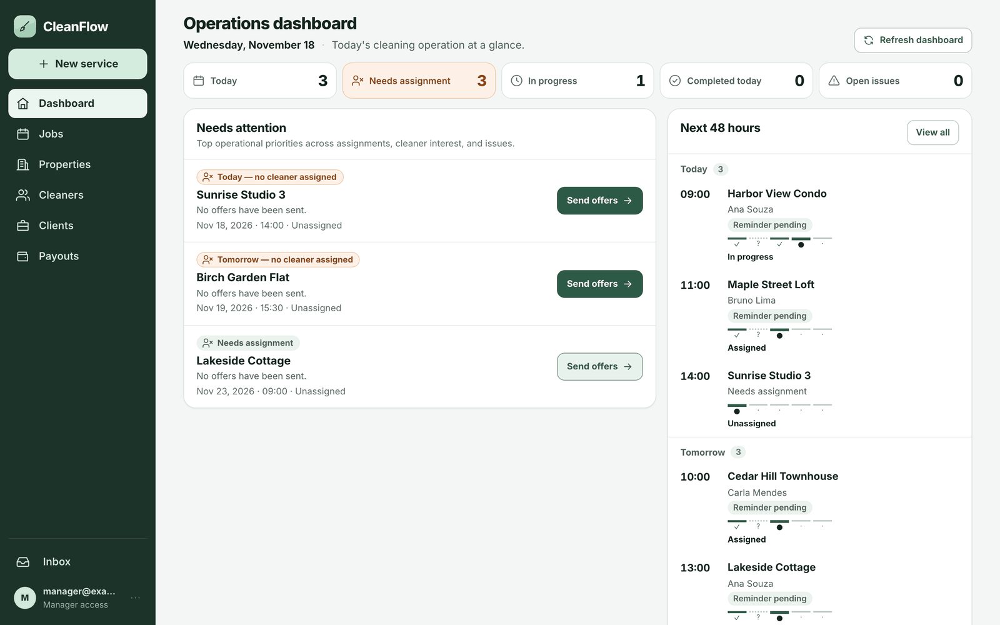
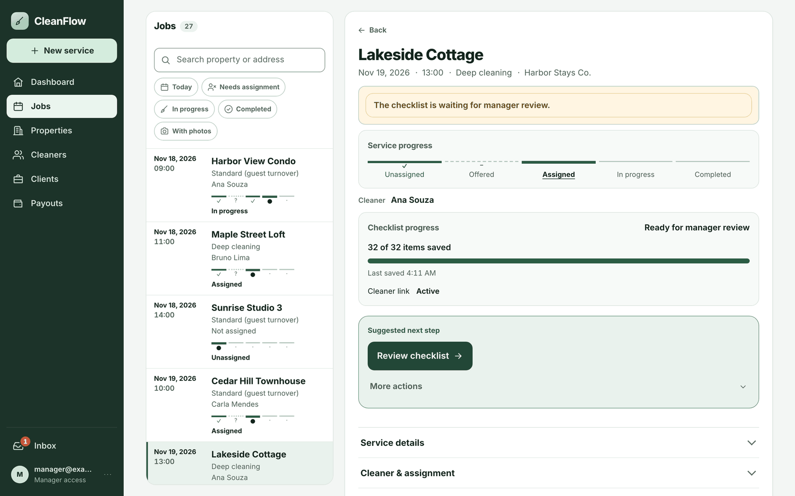
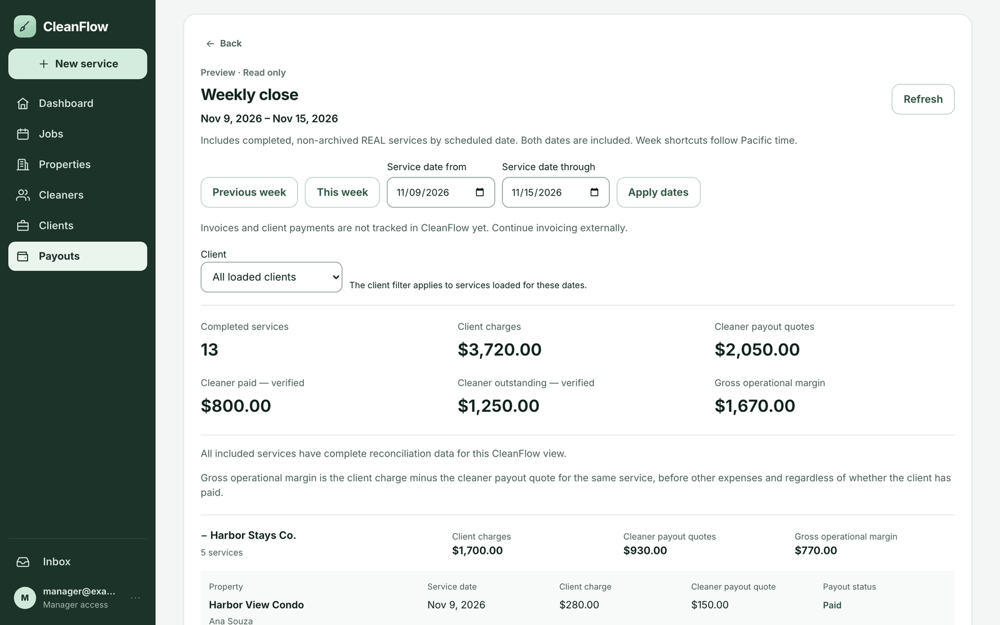
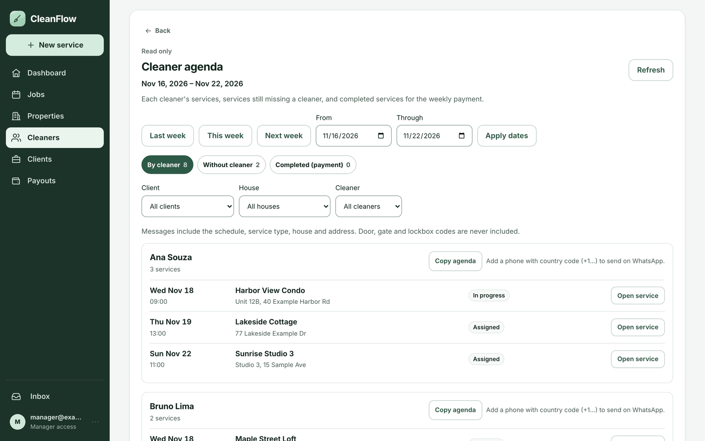
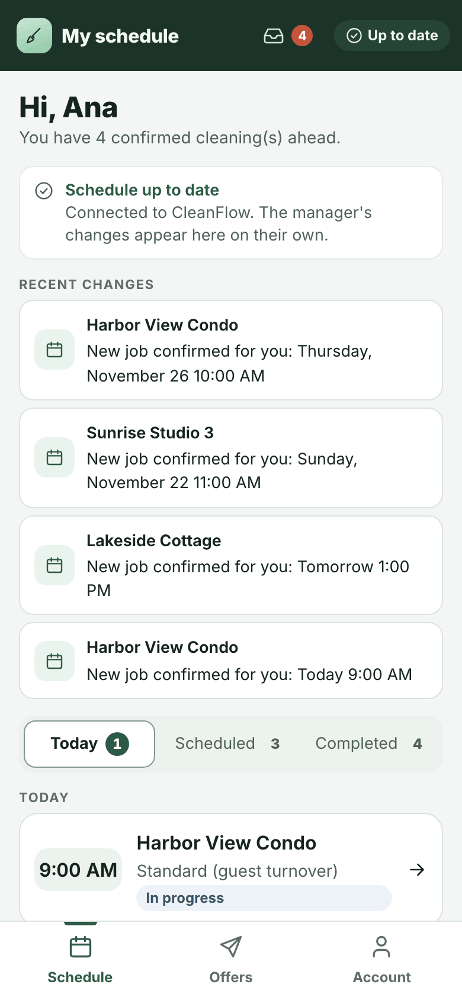
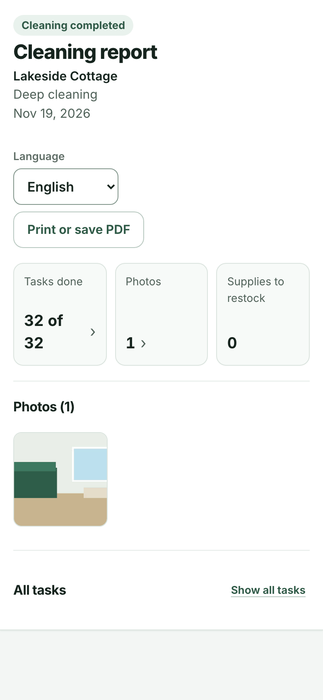
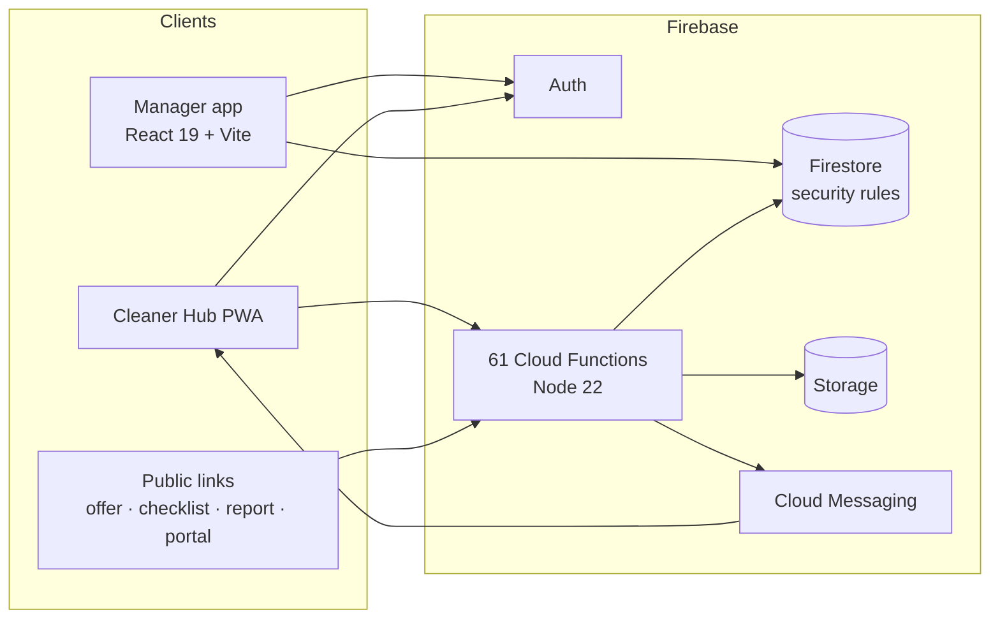

# CleanFlow

**A realtime operations platform for cleaning companies — built solo, running in production, and used every day by a real cleaning business.**

[](https://github.com/irvingellan/cleanflow/actions/workflows/engineering.yml)


Built by **Irving Ellan** · [LinkedIn](https://www.linkedin.com/in/irvingellan) · [Website](https://irvingellan.com)

CleanFlow replaces the WhatsApp threads, spreadsheets and memory that small cleaning teams run on with one
structured workflow: a service is scheduled, offered to cleaners, assigned, executed with a photo checklist,
reported to the client and closed out for payment. Managers work on a laptop; cleaners work from their phones.

> All screenshots and data in this repository are fictitious. The production deployment serves a real
> short-term-rental cleaning operation; its data never leaves its Firebase project.

<p align="center">
  
</p>

| Service detail | Weekly close |
| --- | --- |
|  |  |
| **Cleaner agenda (manager view)** | **Cleaner Hub (phone) · Client report** |
|  |   |

## What it does

| For the manager | For the cleaner | For the client |
| --- | --- | --- |
| Operations dashboard: today's services and what needs attention | **Cleaner Hub** PWA: agenda, offers, push notifications | Cleaning **reports with photos** |
| Services by type: turnover, deep cleaning, move-in/out, post-construction | Accept an offer — first accept wins, enforced on the server | A read-only **client portal** |
| Offers to one or many cleaners, direct assignment, replacement | Photo checklist for each property | Shared through revocable token links |
| Weekly agenda per cleaner, copied to WhatsApp with reschedule highlights | | |
| Weekly close: client charges vs cleaner payouts, never mixing incomplete data | | |
| Issues, history, archive and audit trail | | |

English, Portuguese and Spanish throughout — the team is multilingual.

## Architecture



- **Server-mediated trust.** Cleaners and public links never read Firestore directly: every action goes through a
  callable Function that checks identity, organization and token scope. Security rules are tested in the emulator.
- **Explicit state machines** for the service lifecycle, offers and assignments instead of loose UI flags.
- **Layered features** (`ui → hooks → services → provider`) so business rules stay testable without Firebase.
- **One bundle per entry point** (manager, cleaner, public pages), lazy-loaded, for a fast first paint on phones.
- **Read deadlines** on every one-shot query, so a stalled realtime channel on iOS Safari becomes a handled
  error instead of a 30-second hang — a problem found through production telemetry.

## Engineering practices

| Practice | How |
| --- | --- |
| Testing | **2,000+** Vitest unit and component tests, Playwright end-to-end suites on Chromium and WebKit, emulator-backed security-rules tests |
| CI | Every pull request into `main` runs unit tests, the emulator build, the security suites and every browser suite |
| Releases | A release script rebuilds the live version byte-for-byte as an instant rollback, checks CI and per-function environment, then deploys |
| Refactoring | A multi-phase plan landed as small reviewed PRs with no behavior change — e.g. `App.jsx` 1,812 → 74 lines, `JobDetail.jsx` 2,511 → 1,161 |
| Observability | Page-load and operation telemetry with timeouts, used to find and fix slowness on real devices |
| Privacy | No real names, addresses, access codes or payment data in the repo; door codes never appear in notifications or URLs |

## Built with AI agents — deliberately

I design, review and ship; AI coding agents (Claude Code, Codex) help implement. The repository is set up for that:

- [`AGENTS.md`](AGENTS.md) and [`docs/AI_DEVELOPMENT_PLAYBOOK.md`](docs/AI_DEVELOPMENT_PLAYBOOK.md) define the constraints every agent follows.
- Large changes start as a written plan, then land as chained PRs that each pass the full CI.
- Every agent PR is reviewed line by line and checked in the real app before release.

The result: one developer maintaining a production system with the safety net of a team.

## Tech stack

| Area | Technology |
| --- | --- |
| Frontend | React 19, Vite, PWA, CSS design tokens (light and dark) |
| Backend | Firebase Cloud Functions (Node 22), Firestore, Storage, Auth, Cloud Messaging |
| Testing | Vitest, Testing Library, Playwright, Firebase Emulator Suite |
| CI/CD | GitHub Actions, scripted releases with rollback |
| i18n | English, Portuguese, Spanish |

## Run it locally

```bash
npm install
npm run dev                                 # the app against emulators or your own Firebase project
npm test                                    # unit and component tests
npm run test:e2e                            # emulator-backed browser tests
npm run scenario -- weekly-close --watch    # replay a fictional end-to-end scenario
```

## Documentation

- [`docs/PRODUCT.md`](docs/PRODUCT.md) — the problem and the product
- [`docs/DATA_MODEL.md`](docs/DATA_MODEL.md) — domain model
- [`docs/WORKFLOWS.md`](docs/WORKFLOWS.md) — lifecycles and state transitions
- [`docs/DECISIONS.md`](docs/DECISIONS.md) — architecture decision log
- [`docs/ROADMAP.md`](docs/ROADMAP.md) — what comes next

## Author

**Irving Ellan** — software developer. I built CleanFlow end to end: product discovery with a real operator,
architecture, implementation, testing and production operations.

**Open to software engineering roles.**
[LinkedIn](https://www.linkedin.com/in/irvingellan) · [Website](https://irvingellan.com) · [GitHub](https://github.com/irvingellan)
